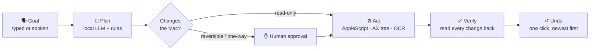

<div align="center">

# Human Emulator

**An accessibility-first AI agent that operates your Mac — on-device, verified, undoable.**

Describe an outcome in plain English (typed or spoken). A local language model plans it,
Human Emulator carries it out on real Mac apps, **proves every change by reading it back**,
and can **undo the whole mission** with one click.

No API keys. No cloud. It keeps working with Wi-Fi turned off.


</div>

---

## Contents

- [Why Human Emulator](#why-human-emulator)
- [How a mission works](#how-a-mission-works)
- [Features](#features)
- [Quick start](#quick-start)
- [Using it](#using-it)
- [Architecture](#architecture)
- [Safety by design](#safety-by-design)
- [Choosing the model](#choosing-the-model)
- [Project structure](#project-structure)
- [Tests](#tests)
- [Limitations](#limitations)
- [Team](#team)

## Why Human Emulator

Most computer-use agents take a screenshot, send it to a cloud vision model and guess where to click.
That is slow, costs money on every step, breaks when the layout changes, and sends your screen to a server.

Human Emulator takes a different path:

- **Native channels first.** It drives apps through AppleScript and the macOS **Accessibility tree**, pressing controls by name.
  On-device OCR (Apple Vision) is only a fallback.
- **A small local model plans, code executes.** The model only picks from a catalog of audited, typed actions.
  It never writes or runs its own code.
- **Proof, not claims.** Every change is independently read back from the app or the file system before it is marked done.
- **Reversible by default.** Every reversible step stores undo data, so a whole mission can be rolled back newest-first.

## How a mission works



Every step in a plan is labelled **read-only**, **reversible** or **one-way** before anything runs.
Read-only plans run immediately; anything that changes the Mac waits for **Approve**.

## Features

| Capability | How it works |
| --- | --- |
| **On-device brain** | `qwen3.5:2b-q4_K_M` runs locally through Ollama at `127.0.0.1:11434` (chosen by [benchmark](#choosing-the-model)). The dashboard shows live tokens/sec. |
| **Audited actions only** | The model chooses from 24 typed actions in [`actions.py`](actions.py). Constrained JSON decoding enforces each action's arguments. |
| **Proof, not claims** | Reminder due dates read back from Reminders, file SHA-256 rechecked, volume read from Core Audio, Pages text read back from Pages, VS Code window titles read through Accessibility, sent WhatsApp bubbles found in the chat. |
| **One-click undo** | Missions roll back newest-first. Files go to a recoverable undo bin, never permanent deletion. Undo data survives restarts. |
| **Talk to it** | Press **Talk** or <kbd>⌥ Space</kbd>. Apple's on-device SpeechAnalyzer transcribes in under a second, and replies are spoken with the macOS voice. Say “yes”, “no”, “stop” or “undo that”. |
| **Routines** | “Every weekday at 8:30am, read my agenda aloud” is planned and approved once, then replayed on schedule with no model call, still verified and undoable. |
| **Hands on real apps** | Reminders, Calendar, Notes, Pages (headings + PDF export), VS Code, Calculator, WhatsApp, System Settings, files and folders. |
| **Any app, by name** | “Press Battery in System Settings” finds the control in the Accessibility tree; only if it is not there does Apple Vision OCR locate the text and click it. |
| **Describe my screen** | Reads a window with on-device OCR, summarises it with the local model and speaks it, for users who cannot see the screen. |
| **Honest refusals** | Email, SMS, purchases, deletion or live web lookups are named as out of scope instead of being silently dropped. |
| **Deterministic where it matters** | Dates (“Thursday 4pm”) and schedules (“every Monday at 6pm”) are parsed by code, not by the model. |
| **Mission Control dashboard** | Live plan streaming, risk badges, flight log, proofs, history, a ranked mission deck, and animated “living edges” driven by real engine events. |

## Quick start

### Requirements

- macOS 26 or later on Apple silicon
- [Ollama](https://ollama.com) 0.40 or later — `brew install ollama`
- Python 3.11+
- Xcode command-line tools (for `swiftc`) — `xcode-select --install`

### Run

```bash
git clone https://github.com/hammidbinaejaz/Human-Emulator.git
cd Human-Emulator
./run.sh
```

The launcher:

1. Starts Ollama if it isn't running.
2. Downloads the model once if missing (the only step that needs internet).
3. Creates a `.venv` and installs the Python dependencies.
4. Checks macOS permissions.
5. Starts the server on `127.0.0.1:8765` and opens the dashboard.

If the dashboard is already running, it just opens it again. Press <kbd>Ctrl</kbd>+<kbd>C</kbd> to stop.

### Optional: the `hi human emulator` shortcut

Add this to `~/.zshrc` (replace the path with where you cloned the repo):

```zsh
# >>> Human Emulator launcher >>>
hi() {
  if [[ "${(L)*}" == "human emulator" ]]; then
    echo "👋 Hi! Launching Human Emulator…"
    "$HOME/path/to/Human-Emulator/run.sh"
  else
    echo "Try: hi human emulator"
    return 1
  fi
}
# <<< Human Emulator launcher <<<
```

Then, in any new Terminal window:

```bash
hi human emulator
```

### Configuration

```bash
CASE_MODEL=qwen3.5:4b-q4_K_M ./run.sh   # same accuracy in our benchmark, ~2.6× slower, 2× the memory
CASE_MODEL=qwen2.5:3b ./run.sh          # the previous default
CASE_VOICE=Samantha ./run.sh            # spoken replies (default: Daniel)
CASE_PORT=9000 ./run.sh                 # dashboard port (default: 8765)
CASE_CALENDAR="Work" ./run.sh           # calendar used for new events
CASE_NO_BROWSER=1 ./run.sh              # don't open the dashboard automatically
```

> [!NOTE]
> Use the `-q4_K_M` (GGUF) model tags. Ollama's plain `qwen3.5:2b` tag downloads an MLX build on Apple silicon,
> which cannot do the constrained JSON output the planner relies on.

### macOS permissions

On first use, macOS asks to let the app running Human Emulator (Terminal, VS Code, …) control
**Reminders, Calendar, Notes, Pages and System Events**. It also needs **Accessibility** (to drive apps
and read windows) and **Screen Recording** (to read the screen). The browser asks for the **microphone**
the first time you press **Talk**. `run.sh` prints a checklist and opens System Settings where needed.

## Using it

### Example missions

| Mission | What happens |
| --- | --- |
| **Viva prep kit** | “Set up my viva prep: create a Viva Prep folder on the Desktop with a checklist of 5 things to rehearse, remind me tomorrow at 9am to rehearse, and block 45 minutes on Thursday at 4pm for a mock viva” — one sentence, four verified changes, one-click undo. |
| **Calculator** | “Use Calculator to work out 128 × 46” — buttons pressed by name, display read back and checked against an independently computed answer. |
| **Pages essay** | “Write a one-page essay about why on-device AI agents matter in Pages and export it as a PDF” — the local model writes it, Pages formats it, the text and PDF are verified. |
| **VS Code** | “Open my final year project folder in VS Code” — proof is the window title read through Accessibility. |
| **WhatsApp** | “Say hi to Sam on WhatsApp” — marked *one-way*; confirms the chat header names the contact before typing and finds the sent bubble afterwards. |
| **Describe my screen** | Reads the last-used app's window with on-device OCR and speaks a summary. |
| **Deep work mode** | “Switch to dark mode, set volume to 15, and remind me in 25 minutes to take a break” — three reversible changes, each read back. |
| **Safety check** | “Order a pizza for dinner and email my boss that I'm running late” — declared out of scope; nothing unsafe runs. |

### Talk to it

Press **Talk** or <kbd>⌥ Space</kbd> and speak naturally; recording stops when you pause.

- Audio is sent only to `127.0.0.1` and transcribed by Apple's on-device speech model.
- Missions started by voice answer back — “Plan ready. 2 steps … Shall I go ahead?” — then listen for your answer.
- Say **yes / go ahead**, **no / cancel**, **stop** (while running) or **undo that**. Only a clear yes approves;
  anything hesitant (“okay, wait”) cancels or waits instead.
- <kbd>Esc</kbd> cancels listening or stops the voice.

### Routines

Start a goal with a schedule — “every day at 9am”, “every weekday at 8:30”, “every Monday and Thursday at 6pm”, “every 2 hours”:

1. Human Emulator plans the rest of the sentence and shows a **ROUTINE** banner.
2. **Save routine** approves that exact plan; nothing runs now.
3. At each scheduled time the approved steps replay **without the model**, and every step is still verified and undoable.

Any finished mission can also become a routine with **⏱ Make it a routine**. Routines run while the server is running;
a run missed by more than two hours (for example while the Mac was asleep) is skipped, not run late.

### History

- **✕** on a history row or **Delete mission** removes a mission and any screenshots it captured. **Clear all** removes every finished mission.
- **↻ Restart** restarts the server in place; the dashboard reconnects by itself.
- State lives in `~/.case-mission/` — delete `missions.db` there to start with an empty history.

## Architecture

```
dashboard (static/)  ──SSE + JSON──▶  server.py (FastAPI, loopback only)
  voice.js (mic, WAV)                    │        └── voice.py → case-listen (Apple SpeechAnalyzer), say
                                     engine.py   plan → approve → act → verify → undo, routines + scheduler,
                                     │       │   SQLite (store.py)
                              planner.py   actions.py (24 audited actions)
                                 │             │
                             llm.py         macos.py → osascript (argv only), screencapture,
                          (Ollama, JSON         case-ocr (Apple Vision), case-ax (Accessibility), pbcopy, say
                           schema decoding)
```

| Layer | Files | Role |
| --- | --- | --- |
| Dashboard | `static/` | Vanilla JS + CSS. Live plan streaming over Server-Sent Events, mission deck, voice capture, animated wordmark and edges. |
| Server | `server.py` | FastAPI on `127.0.0.1` only, with Host/Origin checks against DNS rebinding. |
| Engine | `engine.py`, `store.py`, `schedule.py` | Mission lifecycle, approvals, verification, undo, routines and the scheduler; SQLite persistence. |
| Planner | `planner.py`, `intents.py`, `llm.py` | Rule-based fast paths + schema-constrained JSON from the local model, then validation and deterministic repairs. |
| Actions | `actions.py`, `timeparse.py` | The audited action catalog — each action has typed args, a run step, a proof check and an undo. |
| macOS bridge | `macos.py`, `native/*.swift` | Injection-safe AppleScript (user text only as `argv`), screenshots, and three small Swift helpers compiled on first use: Vision OCR, Accessibility, and SpeechAnalyzer. |

### Planner reliability

Small on-device models make small mistakes, so the planner doesn't trust them blindly:

- The JSON schema has one variant per action, with arguments in natural order (constrained decoding fixes property order).
- The validator maps argument aliases, rejects placeholders such as `[Name]`, renumbers `{{stepN}}` references and asks the model to repair a plan once.
- Deterministic repairs fix common slips — an invented folder name is replaced by the one the user actually named,
  `open_path` + `open_app(VS Code)` becomes `open_in_vscode`, and “as a PDF” turns on the Pages export.
- Reminders and calendar blocks keep the user's own time words, so “in 25 minutes” can't become “Thursday 2:25pm”.
- Steps copied from few-shot examples instead of the request are removed.
- WhatsApp, Calculator, “press X in Y”, “describe my screen”, Pages essays and small talk are parsed by rules and planned in milliseconds.

## Safety by design

- **No code execution by the model** — only typed, audited actions.
- **Human approval** for anything that changes the Mac; every step shows its risk.
- **Paths are confined** to Desktop, Documents and Downloads (symlink escapes included), and approved paths are never swapped at run time.
- **AppleScript receives user text only as `argv`**, never spliced into scripts.
- **WhatsApp guard:** `send_whatsapp` is dropped unless the goal mentions WhatsApp *and* names that contact. Before typing, the chat header must
  name exactly that contact, the message box must hold exactly the approved text, and the clipboard is never touched.
- **Edits are protected on undo:** a Pages document you changed after creation is kept, not deleted.
- **Loopback-only server:** requests whose `Host` isn't `127.0.0.1`/`localhost` are rejected; state-changing requests need the dashboard header and a same-origin `Origin`.

## Choosing the model

[`bench.py`](bench.py) plans 10 realistic missions per model (nothing is executed) and checks the actions and key arguments:

```bash
.venv/bin/python bench.py qwen2.5:3b qwen3.5:2b-q4_K_M qwen3.5:4b-q4_K_M
```

Results on an 8 GB M1 MacBook Air (Ollama 0.40.15):

| Model | Correct plans | Median plan time | Generation | Memory |
| --- | --- | --- | --- | --- |
| qwen2.5:3b | 7/10 | 5.2 s | 19.6 tok/s | 2.1 GB |
| **qwen3.5:2b-q4_K_M** (default) | **9/10** | **4.9 s** | **23.2 tok/s** | **1.6 GB** |
| qwen3.5:4b-q4_K_M | 9/10 | 12.7 s | 9.3 tok/s | 3.1 GB |

The 2b model's one miss (forgetting the PDF export) is now repaired by the validator. Qwen 3.5 models can “think” before answering;
`llm.py` turns that off because plans are schema-constrained JSON.

## Project structure

```
Human-Emulator/
├── run.sh            # one-command launcher: Ollama + model + venv + server + dashboard
├── server.py         # FastAPI app (loopback only), SSE event stream
├── engine.py         # plan → approve → act → verify → undo, routines + scheduler
├── planner.py        # goal → validated plan (constrained JSON + repairs)
├── intents.py        # rule-based fast paths (WhatsApp, Calculator, Pages, small talk…)
├── llm.py            # Ollama client
├── actions.py        # the audited action catalog (run · proof · undo)
├── macos.py          # injection-safe osascript, screenshots, permissions
├── timeparse.py      # deterministic date/time parsing
├── schedule.py       # routine schedules
├── store.py          # SQLite persistence
├── voice.py          # on-device speech-to-text + spoken replies
├── preflight.py      # macOS permission checklist
├── bench.py          # model benchmark
├── native/
│   ├── case_ax.swift      # Accessibility tree: find & press controls, read windows
│   ├── case_ocr.swift     # Apple Vision OCR
│   └── case_listen.swift  # Apple SpeechAnalyzer transcription
├── static/           # Mission Control dashboard (HTML/CSS/JS)
└── tests/            # pytest suite
```

## Tests

```bash
.venv/bin/python -m pip install pytest
.venv/bin/python -m pytest -q
```

The suite (139 tests, ~6 s) covers time and schedule parsing, path confinement and symlink escapes,
plan validation and repairs, the WhatsApp guard, the full engine lifecycle with fake actions (approval, failure halting,
chained outputs, undo order, restart recovery, routines and missed runs), voice transcript fixes, and server security checks.

## Limitations

- A small on-device model plans in about 3–13 s on an 8 GB Mac and sometimes writes generic text.
- `read_agenda` uses Calendar's AppleScript query, so recurring events may be missing.
- `open_path`, `open_in_vscode`, `speak` and `send_whatsapp` cannot be undone — their approval badge says so.
- WhatsApp is driven through its on-screen controls, so it depends on WhatsApp's English accessibility labels.
- Speech recognition follows the Mac's language; unknown app names are corrected by a small list in `voice.py`.
- Routines run only while the server is running.
- The first screen read after a reboot loads Apple's Vision models (the server pre-warms them at startup).

## Team

Final Year Project · **Team 18** · Dept. of CSE (AI & ML), Sai Vidya Institute of Technology, Bengaluru (VTU) · 2025–26

- Hammid Bin Aejaz
- Mayank Thakur
- Bupesh Kattri
- Neelesh Raikwar

Guide: **Dr. Kumaresh Sheelavant**
